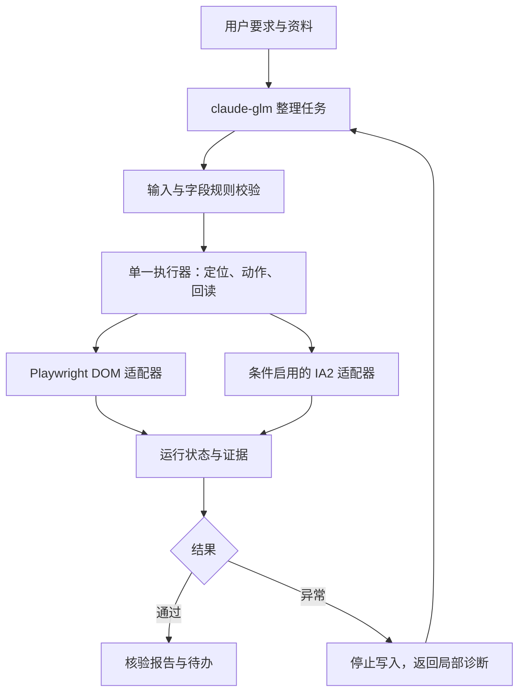

# feature01 独立评估与解决方案：基于 claude-glm 的企业微信 OA 自动化

评估日期：2026-10-21。生产环境：Windows + Git Bash + Claude Code CLI，通过 `claude-glm` 启动，使用 GLM 模型。

本文独立读取指定复盘、相关实测报告、现有探针代码和仓库内的 claude-glm 配置包，并重新核对原始 JSONL。原始日志中，真实模型消息均标记为 `glm-5.3`。本文提出实施方案；本次没有操作 OA、修改生产配置或安装工具。

**我的判断：保留 claude-glm 作为任务入口，把已经明确的填单过程交给带校验、断点和停止条件的程序。先用有限时间验证浏览器路线，验证成功后优先采用 Playwright；不成立时，只保留能够可靠识别字段的桌面操作，其余字段交给人工。**

当前最应解决的是三件事：准确定位目标字段、让执行过程脱离逐步模型推理、在失败或重启后可靠恢复。更大上下文、更多 Workflow 或更强推理都不能代替这三件事。

## 1. 对原复盘的独立评估

### 1.1 我认同的判断

| 判断 | 我的评估 |
|---|---|
| 每个字段都通过模型反复“读快照、找坐标、点击、再读快照”，成本过高 | 成立。相同表单应在首次适配后转为程序执行，模型只处理新需求和异常。 |
| 多个代理共同操纵同一桌面，无法加速主操作链 | 成立。同一桌面需要一个动作执行者。并行分析可以辅助开发，不能让多个执行者同时点击。 |
| 缺少持久化知识会造成重复探索 | 成立。字段含义、已失败方法和当前进度必须保存到文件，并由程序读取。 |
| 页面位移导致银行字段被错误写入，是严重架构问题 | 成立。输入前没有确认目标身份，长动作链又缺少逐步验证，容易把一次偏移扩大成连续错填。 |

### 1.2 需要纠正的统计和结论

**第一，77.5M token 的统计存在重复累加。**

本次读取的原始文件为：

```text
C:\Users\xy24\.claude-glm\projects\D--Technique-Support-Claude-Code-Learning-Hot-Fix\e122641b-84fb-4274-bf70-d9bc055d0a13.jsonl
```

文件与复盘覆盖范围一致：2219 行、5,968,218 字节，最后时间为北京时间 2026-10-21 10:49:03。日志把同一个模型消息的 thinking、text、tool_use 等内容拆成多条助手记录，相关记录又重复携带 usage，因此不能逐行累加 usage。

| 指标 | 原复盘口径 | 本次核查结果 |
|---|---:|---:|
| 助手记录数 | 1086 | 1086 条记录，不能直接当作模型轮次 |
| 真实模型消息 ID 数 | 未区分 | 410 个；另有 2 个 synthetic 消息 ID |
| 非缓存输入 tokens | 2,523,276 | 958,432 |
| 缓存读取 tokens | 73,806,272 | 28,318,720 |
| 输出 tokens | 1,158,370 | 351,521 |
| 上述三类合计 | 77,487,918 | **29,628,673，约 29.63M** |
| 自动压缩事件 | 8 次 | 8 次，核查一致 |
| Bash / Workflow 调用 | 320 / 2 | 按 tool_use.id 去重后仍为 320 / 2 |

去重方法：按 `message.id` 分组，排除 `<synthetic>`，每组取最后一条 usage。本文件中，“取最后一条”和“各 usage 字段取组内最大值”的汇总结果一致。453 个工具调用 ID 均唯一，工具调用数没有同样的重复问题。

**29.63M 仍然说明任务很重，但它只是该主日志可见的 usage 汇总。** 它没有补齐独立子任务日志、服务端内部重试或未记录的其他请求，也不是供应商账单。缓存输入、普通输入和输出不能按同一价格理解。用会话总 token 除以 113 条链，还混入了安装、补丁、测试和探索，无法代表成熟填单程序的单链成本。

**第二，8 次自动压缩不等于 8 次模型上下文硬耗尽。**

8 次 `compact_boundary` 的 `preTokens` 分别为：

```text
113985 / 109328 / 106664 / 107866 / 108252 / 108245 / 109302 / 108448
```

这证明会话在约 10.7万～11.4万 token 时自动压缩。日志记录的压缩耗时合计约 14.54 分钟；它不足以直接解释全部墙钟时间。压缩后的重复探索值得治理，但不能把每次压缩都解释为全部战术知识清空。

**第三，发现 OA URL，只证明存在浏览器路线的候选入口。**

目前没有证据证明独立浏览器可以继承企微登录态、通过 SSO、打开同一草稿，并正常操作复杂表格。原实测报告也明确把这些列为待验证项。因此，不能承诺“换 Playwright 就分钟级完成”。

**第四，DOM 定位也需要业务身份校验。**

Playwright 的 Locator 会在动作时重新定位元素，能够减少旧坐标造成的错误；但错误选择器、重复控件、错误表格行、iframe 和虚拟化表格仍然可能让程序操作错对象。它改善定位机制，不能自动理解报销业务。[Playwright Locator 文档](https://playwright.dev/docs/locators)

### 1.3 我重新排列的根因优先级

1. **缺少字段级执行契约。** 系统没有明确表示“该字段属于哪个区块、是否可写、如何定位、怎样证明写入成功”。这使自动计算字段、同名字段和银行字段都需要临场猜测。
2. **探索和生产填写混在同一个长会话中。** 未完成适配就持续填真实表单，失败后继续增加临时脚本，没有明确退出条件。
3. **模型承担了可以确定性执行的操作循环。** 每次常规动作都付出模型请求、工具调用和上下文处理成本。
4. **状态和异常知识没有成为程序输入。** 重启或压缩后，执行者重新根据聊天记录推测现场。
5. **claude-glm 的有效配置缺少核查。** 配置包声明的上下文设置与实际压缩位置存在差异；模型别名也容易被误当作能力分层。

## 2. claude-glm 对方案的实际约束

### 2.1 Claude Code 是运行框架，实际推理由 GLM 提供

仓库中 2026-10-12 同步的启动脚本显示，默认 Zhipu 路线使用 `https://api.z.ai/api/anthropic`，并把 Opus、Sonnet、Haiku 和子代理位置都映射到 `glm-5.3`。原任务日志的模型字段也与此一致。

因此，**把任务交给名为 Haiku 的位置，不能据此推断会更快或更省**。应该记录实际 provider、模型映射和请求延迟，不能根据客户端显示的别名设计性能方案。Z.AI 官方提供 Claude Code 接入方式，但本项目的具体映射以启动脚本和实际运行记录为依据。[Z.AI Claude Code 接入文档](https://docs.z.ai/devpack/tool/claude)

本文沿用当前 GLM 路线。执行器自身不再调用大模型，避免新增一套模型服务和编排系统。

### 2.2 视觉能力必须验证完整调用链

已有页面探索报告记录：远程视觉工具连续 5 次返回 500。该事实说明当时那条工具链不可用，不能据此推断 GLM 的全部视觉能力；同样，客户端能读取 PNG、返回图片 URL，也不能证明当前模型已经看到了图片。

若需要视觉兜底，先用无业务数据的本地图片验证“传入图片 → 返回文字与位置 → 执行器可使用结果”。Z.AI 有独立 Vision MCP 接入方式，可作为候选，但官方支持不等于本机已经可用。[Z.AI Vision MCP 文档](https://docs.z.ai/devpack/mcp/vision-mcp-server)

视觉工具连续两次相同故障即停止本轮验证。结构化路线能覆盖的字段，不再依赖远程图片分析。

### 2.3 上下文配置需要查生效值，不能只查配置文件

配置包写有：

```text
CLAUDE_CODE_MAX_CONTEXT_TOKENS=1000000
CLAUDE_CODE_AUTO_COMPACT_WINDOW=400000
CLAUDE_AUTOCOMPACT_PCT_OVERRIDE=60
```

包内记录给出的名义压缩预期约为 240K，但本次生产日志实际约 107K～114K。**这构成待调查的差异，尚不足以断言是某个变量失效。**

实施时只读核查启动命令、Claude Code 版本、实际 `CLAUDE_CONFIG_DIR`、模型 ID，以及启动进程继承的上述变量；核对项目设置、命令行覆盖和恢复会话的影响。只输出指定非敏感项，不打印完整环境或 Key。

Claude Code 对自定义模型 ID 提供上下文窗口覆盖机制，但变量的适用条件与模型 ID、客户端版本有关。是否修改，应依据生产版本文档和新会话实测；声明 1M 不会让服务端自动获得 1M 能力。[Claude Code 自定义模型上下文配置](https://code.claude.com/docs/en/model-config#which-ids-claude_code_max_context_tokens-applies-to)

这项排查与执行器改造可以分别进行。执行器正确性必须独立于聊天压缩阈值，不能靠关闭压缩或无限扩窗保证完成任务。

## 3. 路线选择：先做一次限时能力验证

**优先验证独立浏览器，技术探索预算 30 分钟。** 这是止损预算，不是成功时限承诺；需要扫码或人工登录时，单独记录等待，当前运行停止在登录关口。

| 检查项 | 必须取得的证据 | 不通过时的处理 |
|---|---|---|
| 浏览器入口与登录 | 正常访问 OA；登录后显示正确人员、公司和权限 | 不复制未知企微凭证；记录登录阻塞 |
| 草稿定位 | 能定位指定单据或明确的授权测试草稿 | 不用 `type=new` 代替恢复旧单据 |
| 页面结构 | 识别表头、报销明细、费用说明和银行信息的容器及字段关系 | 检查 iframe、虚拟化或 canvas；不继续猜 CSS 序号 |
| 普通字段 | 在允许写入的草稿中，完成一次输入、失焦、回读 | 仅能看到字段，不能算执行路线通过 |
| 困难字段 | 对一个代表性选择器或表格单元格完成选择、回读 | 只验证普通输入框不能覆盖本次真实难点 |
| 恢复能力 | 再次进入同一草稿后，能够确认身份和当前值 | 不假定重开页面后状态仍在 |

第一轮先完成只读检查。涉及写入的验证必须使用已授权的目标和字段；没有该范围时，路线状态保持“只读可用、写入待验”。本文本身不构成 OA 写入授权。

登录状态应在受控浏览器内正常建立。若采用持久浏览器配置或认证状态文件，应单独保存、排除版本管理，并验证刷新和重启后的有效性。`storageState` 也不能被视为所有 SSO 的通用迁移方案，例如 sessionStorage 需要额外处理。[Playwright 认证文档](https://playwright.dev/docs/auth)

30 分钟后只输出三种结果之一：

- **DOM 路线通过：** 以 Playwright 代码执行为主，停止扩展坐标脚本。
- **受登录或系统能力阻塞：** 把证据交给系统管理员或用户解决；当前任务采用已验证的局部桌面路线或人工补齐。
- **DOM 不适合该控件：** 评估 IA2 能否提供稳定身份；仍无法区分目标时，该字段交给人工。

界面已有“导入”“导入模板”线索。实施时顺带确认是否存在适用的官方模板；只有验证它覆盖目标明细、关联关系和校验规则后才使用。第三方 OA 的业务 API 同理，需要该 OA 的真实接口和权限依据，不能从企业微信有 API 推导出报销单可直接写入。

## 4. 推荐架构：一个执行器，模型处理任务与异常



GLM 负责把用户材料整理成受校验的任务、解释不确定业务项、协助首次适配和处理异常。执行器负责所有已知字段的定位、输入、等待、回读和状态保存。一次执行命令可以在程序内完成多个字段，不需要每填一格都回到模型。

首版使用现有 Bash 调用一个本地程序即可，不必先开发新的 MCP 服务。需要频繁复用时，再把同一执行器封装为少量业务级工具，避免把几十个底层鼠标工具继续暴露给主循环。

**批量执行指减少模型往返，每个字段仍然单独验证。** 不能简单把 20 个旧坐标拼进一个 chain，就称为效率优化。

## 5. 先建立字段规则，再写自动化动作

每个字段至少定义：业务键、区块、行身份、类型、是否可写、定位方法、前置条件、回读规则和失败处理。

| 字段类别 | 执行规则 |
|---|---|
| 系统自动带出项 | 读取并核验，不主动覆盖人员、公司等身份信息 |
| 汇总或计算项 | 标记为只读；检查明细变化后的计算结果，禁止反复 Type |
| 普通文本、日期、金额 | 根据字段类型规范化；输入后失焦并等待页面处理，再回读 |
| 下拉、人员、部门、科目选择器 | 按弹窗内唯一名称及业务标识选择，核验回填值；不按“第几个”点击 |
| 表格单元格 | 按“区块 + 稳定行键 + 列语义”定位；新增行后重新确认身份 |
| 银行信息 | 使用独立区块规则；账号按字符串处理，精确核对授权资料，不从 OCR 或旧记忆猜值 |
| 附件 | 按文件名、大小及可获得的内容标识核对；上传结果未知时先查重 |

实际字段含义以 OA 和业务资料验证为准。复盘中关于自动汇总金额的发现，应转成规则和用例，不能继续留在聊天说明里。

金额用十进制定点数处理，按已确认的币种、精度和业务关系比较。费用说明、报销明细和转账金额是否必须相等，需要确认口径；不把“金额相同”当作唯一正确性证据。

一旦发现目标草稿已有异常值，先生成“字段、当前值、资料期望值、差异”清单。只有期望值有可靠来源、修改在授权范围内时才修复；未知原值不做猜测回滚。

## 6. 执行循环必须在程序内闭环

以下是逻辑示意，不是已经实现的接口：

```text
确认目标用户、单据、模式和允许修改的字段
获取该单据的执行锁；桌面路线另获取桌面控制锁
对每个字段：
    读取现场，确认区块、行身份及前置条件
    当前值已符合任务要求 → 跳过
    字段只读、身份不唯一或已有非预期值 → 停止并报告
    写入动作开始记录，保存必要的原值与预期值
    重新定位目标，执行一个受限动作
    等待页面更新，按字段类型回读
    通过 → 保存已验证状态
    未通过或结果未知 → 停止后续写入，输出局部证据
结束时核对所有目标字段、行数和业务约束
生成报告，准确区分已填写、已保存和已提交
```

### 6.1 Playwright 路线的约束

优先用角色、标签、稳定业务属性和区块容器组合定位；目标必须唯一。复杂表格要确认编辑器与目标单元格的关系，避免对任意可见 input 写入。不要用 `force`、固定 sleep 或脚本直接赋值来掩盖定位和事件问题。

Playwright 自带动作可执行性检查和等待能力，但执行器仍需验证应用实际接收的业务值。[Playwright 自动等待文档](https://playwright.dev/docs/actionability)

### 6.2 IA2 路线的额外约束

继续复用已经验证的 Windows-MCP CEF 补丁，但把它限制为可验证的后备执行层：

1. 保持一个 MCP server 会话承接相关读写，遵守现有前台窗口要求。
2. 每个字段动作前重新获取目标信息；坐标是现场定位结果，不作为跨步骤或跨重启的字段身份。
3. 若控件确实暴露可调用的语义操作，优先使用；不能假定当前 IA2 树已经支持按节点直接写值。
4. 必须用坐标时，同时确认目标窗口、区块、行列关系、局部边界及可见范围。页面滚动、弹窗或重排后，丢弃旧定位结果。
5. 点击后确认实际获得焦点的编辑器属于目标字段，再输入；无法验证焦点归属就停止。
6. 输入后回读目标，同时检查相邻关键字段有无意外变化。银行区等关键区域应在每个动作后立即核验。

**单一锚点的相对坐标不足以解决全部问题。** 页面可能局部重排、表格增高或编辑器浮动。锚点稳定不能证明目标字段稳定；无法建立身份与焦点证据的字段，不应无人值守填写。

## 7. 持久化知识与运行状态

建议在本 feature 下建立以下最小结构，名称为拟定：

```text
automation/
  runner.py                # 任务入口、限时、停止与结果汇总
  form-schema.json         # 字段规则和业务约束
  adapters/                # DOM；确有需要时增加 IA2
  fixtures/                # 脱敏页面或控件样本
  runs/<run-id>/
    task.json              # 本次输入、目标和允许动作
    state.json             # 已确认状态、待确认动作
    events.jsonl           # 动作及校验事件
    report.md              # 人可读核验结果
    evidence/              # 必要局部证据
```

状态至少记录：任务 ID、输入摘要、单据身份、适配器和字段规则版本、已验证字段、最后一次写入状态、未解决差异以及下一步。敏感原值只在必要的受限本地记录中保存，给模型的摘要使用脱敏值。

写状态文件采用原子替换。非幂等动作前写入“待确认”事件，动作后补结果；程序中断后，先查现场再决定是否重试。普通字段设置相同值与“新增一行”“上传附件”“保存”具有不同重试风险，必须分开处理。

恢复时，磁盘状态提供线索，**现场回读决定是否已完成**。重新确认单据身份和关键字段，不因 state 写着成功就跳过核验，也不因进度丢失就新建另一张单。

模型常规只接收状态摘要、差异和证据路径，建议控制在约 1～2KB；全量树和截图留在文件中按需查阅。减少上下文的关键是减少无用输入，而非让模型反复读更长记录。

## 8. 在 Claude Code 中沉淀可重复入口

建议用一份短 `CLAUDE.md` 保存任务入口、停止条件和文件索引；用项目级 `.claude/skills/wecom-oa/SKILL.md` 保存操作规程。Claude Code 官方支持项目级技能和按需附带资源，适合封装已验证的程序入口。[Claude Code Skills 文档](https://code.claude.com/docs/en/skills)

这份技能至少要求：

- 启动前读取字段规则和当前 run 状态。
- 通过执行器运行已知流程，不临时生成旧式坐标链。
- 遇到异常只带回局部证据；确认原因和修正适配器后再继续。
- 严格区分填写、保存、上传、提交等动作范围；沿用已有明确授权，不反复索要相同确认。
- 不把聊天摘要中的坐标当作当前有效定位。

技能是模型操作指南，字段校验和动作限制仍要写进代码。仅写一句“不要误点提交”无法代替执行器限制。

因为 `claude-glm` 使用独立配置目录，实施时必须确认生产会话实际加载到该项目技能。若技能放在 feature 子目录，需要验证从实际启动目录能否发现；不能以“文件已写入”作为验收。短入口文件也应避免堆满历史报告，官方文档同样建议保持 `CLAUDE.md` 简洁。[Claude Code 项目记忆文档](https://code.claude.com/docs/en/memory)

## 9. 设置程序强制执行的止损规则

现有 `wmcp_probe.py` 适合作为探针，但生产使用还缺少业务级限制：chain 主要在 MCP `isError` 时停止，无法判断“工具成功返回、实际写错字段”；单次工具请求允许等待 900 秒。

另外，`_read_msg()` 每次创建读取线程，超时后旧线程没有明确退出机制。若未来改成长驻客户端并在超时后继续发送请求，存在多个线程竞争 stdout 的风险。应改为单一读取器按请求 ID 分发，或复用合适的 MCP 客户端；结果未知时不能直接发下一条写操作。

建议首版使用以下默认值，后续根据实测调整：

| 情况 | 执行器行为 |
|---|---|
| 同一定位或输入方法失败 | 最多 2 次；无新证据时不换坐标反复试 |
| 单个字段超过 60 秒仍未验证 | 停止该阶段，返回原因和局部现场 |
| 常规单次运行超过 15 分钟 | 停止新增写入，保存状态与差异；人工登录等待单独统计 |
| 定位不唯一、焦点不符、用户接管或页面重排 | 立即停止当前动作，重新确认现场 |
| 工具超时、写入结果未知 | 尝试取消并确认旧执行已结束；未确认前保持锁，不启动第二个写入者 |
| 新增行、上传或保存结果未知 | 先检查是否已经生效，禁止直接重复动作 |
| 发生跨字段污染 | 立即停止全部写入，清点影响，不自动猜测修复 |
| 整个任务连续 10 分钟没有新增已验证结果 | 本轮停止，交付阻塞项和可人工完成的清单 |

超时规则必须由执行器或独立看护机制执行。只让模型在提示词里“注意时间”，仍可能重演长时间探索。

## 10. 分阶段落地

以下为初始工作预算，取决于登录条件和表格实现，不是完成保证。

| 阶段 | 交付物 | 退出标准 |
|---|---|---|
| 0：恢复现场与核查环境 | 指定草稿现状、差异清单、脱敏环境记录 | 明确目标身份、已有异常和当前允许动作；停止沿旧链盲填 |
| 1：路线验证，技术预算 30 分钟 | DOM 可行性记录，或明确阻塞证据 | 按第 3 节分类；不无限研究登录和坐标 |
| 2：最小执行器，初始预算 0.5～1 个工作日 | 一个普通字段、一个困难字段的定位／写入／回读；状态与停止机制 | 能处理错误定位、结果未知和中断恢复，再扩字段 |
| 3：完整字段适配，另估 0.5～1 个工作日 | 字段规则、执行器、项目技能和核验报告 | 通过试运行验收；复杂自绘控件另行估算 |
| 4：受控试运行 | 已授权草稿的结果与性能记录 | 达到质量标准后，才扩大无人值守范围 |

遇到不能可靠自动化的少数字段，先让执行器完成已验证部分，输出人工补齐清单和核验结果。不要为了最后一个选择器，再投入数小时无边界试错。

最终报告必须分清：字段已填写但未保存、草稿已保存、附件已上传、流程已提交。没有相应授权或验证时，不把这些状态合并成“已完成”。

## 11. 验收方法与性能目标

先在脱敏样本或测试页面验证失败处理，再在已授权的真实草稿中验证应用行为；本地样本通过不能代替 OA 端到端验证。

| 验收场景 | 通过条件 |
|---|---|
| 普通填写、失焦与回读 | 所有目标字段与资料一致；计算项由页面计算，业务约束通过 |
| 页面滚动、窗口变化或动态增行 | 重新定位或停止，无跨字段写入 |
| 同名选项、重复控件、多个表格 | 按容器与业务身份消歧；不能唯一确定时停止 |
| 自动计算或只读字段 | 执行器拒绝写入，不发生连续 Type 重试 |
| 断网、工具超时、中途退出 | 标记结果未知，恢复后先核验，不重复加行或上传 |
| 重启、压缩或新会话接续 | 读取文件状态并核对现场，无需重做已验证的结构探索 |
| 动作边界 | 执行路径只执行 task 中允许的动作，报告准确反映保存及提交状态 |

建议先做 3 次有代表性的授权草稿试运行，再累计至少 20 次受控运行观察稳定性。**跨字段误写、误提交或不可识别的重复写入均为失败，不能用平均成功率抵消。**

对登录已就绪、字段规则已固定的常规任务，首轮优化目标为：

- 程序完成填写与核验的耗时争取控制在 5～10 分钟；登录、人工补资料、首次适配单独记录。
- claude-glm 只在任务准备、启动、异常和结果解释时介入，常规任务争取控制在 10 次模型往返以内。
- 常规单据执行期间不需要自动压缩；若出现，检查是否又把全量快照和逐字段推理放回了主循环。
- 记录总耗时、模型往返数、已验证字段数、人工接管次数和错误原因；token 按消息 ID 去重并保留缓存分类。

这些是待验证目标。达到目标与否应由实际草稿运行记录证明，不能由工具名称或估算 token 下降幅度推导。

## 12. 建议的首个实施任务

把下一轮 claude-glm 工作限定为：**只读恢复当前草稿与环境，完成一次限时浏览器可行性检查，输出字段规则初稿和路线结论。** 不从下一份 `r*_steps.json` 继续逐坐标尝试。

路线成立后，先实现最小执行器的“定位、写入、回读、停止、恢复”闭环，再扩展到整张报销单。由执行器约束每一步，让 GLM 把判断能力用在任务理解和异常诊断上。

---

本地核查依据：

- [指定复盘：feature01效率复盘-会话记录分析.md](feature01效率复盘-会话记录分析.md)
- [Windows-MCP 路线实测报告](Windows-MCP路线实测报告.md)，特别是 §3 的浏览器待验条件及 §6 的前台、同会话操控验证。
- [企业微信报销单页面探索报告](企业微信-报销单-页面探索报告.md)，用于核对历史视觉故障与页面结构；其中未经验证的业务推断未作为既定规则。
- [现有 MCP 探针](wmcp_probe.py)，用于核对 chain、超时和读取线程实现。
- [claude-glm 配置包说明](<../Claude-glm 配置skill/claude-glm-dist/README.md>)、[启动函数](<../Claude-glm 配置skill/claude-glm-dist/claude-glm.bashrc.snippet>)、[配置模板](<../Claude-glm 配置skill/claude-glm-dist/claude-glm-settings.json>)。它们证明包内配置，不替代生产进程生效值。
- 原始 JSONL：路径见 §1.2；本次仅核查日志与既有文件，没有重新测试 OA 登录、DOM 可操作性或生产长上下文。
